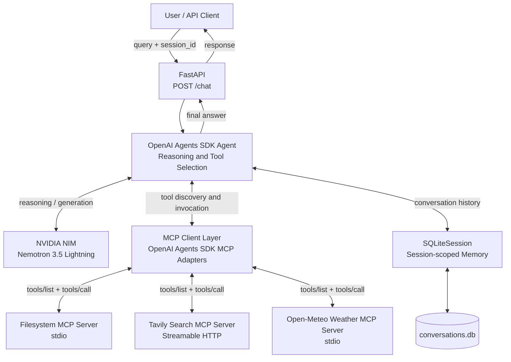
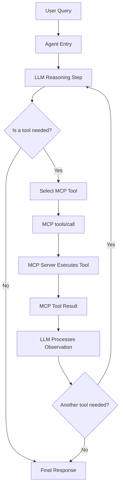
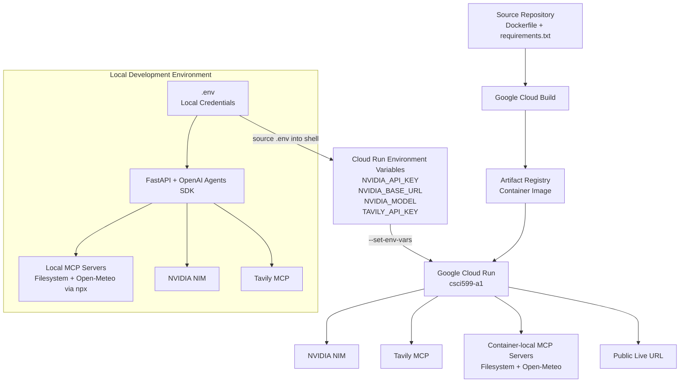

# CSCI 599 Assignment 1 — Tool-Using Agent with MCP Integration

## Overview

This project implements a tool-using AI agent for CSCI 599 Assignment 1.

The application uses:

- **OpenAI Agents SDK** for agent orchestration and MCP integration
- **NVIDIA NIM** with `nvidia/nemotron-3.5-lightning-30b-a3b` as the LLM backend
- **FastAPI** for the HTTP API
- **Filesystem MCP** for local file operations
- **Tavily Search MCP** for web research
- **Open-Meteo Weather MCP** for weather and geocoding
- **SQLiteSession** for session-scoped conversational memory
- **Google Cloud Run** for deployment

The agent decides whether a user query requires a tool, selects an appropriate MCP tool when needed, can perform multiple tool calls in sequence, and remembers previous turns within the same `session_id`.

## Live Deployment

Cloud Run service:

https://csci599-a1-551537131286.us-west1.run.app

FastAPI documentation:

https://csci599-a1-551537131286.us-west1.run.app/docs

The main API endpoint is:

```text
POST /chat
```

Example request:

```json
{
  "query": "What is the current weather in Los Angeles?",
  "session_id": "example-session"
}
```

Example response shape:

```json
{
  "response": "..."
}
```

---

## Architecture

### 1. System Architecture



The FastAPI endpoint receives a user query and a `session_id`. The OpenAI Agents SDK manages the agent execution loop, communicates with NVIDIA NIM for reasoning, and exposes tools discovered through the configured MCP servers.

`SQLiteSession` stores conversation history using the supplied `session_id`, allowing the agent to recall previous turns during the lifetime of the Cloud Run instance.

---

### 2. Tool Invocation Flow



The agent is not limited to one tool call.

For example, a query can first require the agent to read a local file through the Filesystem MCP server and then search the web through Tavily before synthesizing the final response.

The loop-back from the tool result to the reasoning step allows multi-step agentic behavior.

---

### 3. Deployment Topology



Local development uses `.env` credentials and `npx` for the local stdio MCP servers.

During Docker image construction, the Filesystem and Open-Meteo MCP packages are installed into the container. Cloud Run therefore uses the preinstalled MCP executables instead of downloading them at runtime.

The deployment script loads credentials from shell environment variables and passes them to Cloud Run using `--set-env-vars`. API keys are not stored in the repository.

---

## MCP Servers

The agent integrates three MCP servers.

### Filesystem MCP

Implementation:

https://github.com/modelcontextprotocol/servers/tree/main/src/filesystem

The Filesystem MCP server provides tools for interacting with files inside the configured `sample_files` directory.

It is used when a query requires reading or otherwise interacting with local files.

Example:

```text
What does notes.txt say?
```

The server runs locally through the MCP stdio transport.

---

### Tavily Search MCP

Implementation:

https://github.com/tavily-ai/tavily-mcp

Tavily provides web-search capabilities through MCP.

It is used when a query requires current or external web information.

Example:

```text
Search the web for the official Model Context Protocol documentation and summarize it.
```

The Tavily MCP server is accessed through Streamable HTTP using the `TAVILY_API_KEY`.

---

### Open-Meteo Weather MCP

Implementation:

https://github.com/cmer81/open-meteo-mcp

Package:

```text
open-meteo-mcp-server@2.5.2
```

Open-Meteo was added as the third MCP server to demonstrate that the agent can select a domain-specific tool beyond the two core Filesystem and Tavily integrations.

It provides structured geocoding, current weather conditions, and forecasts without requiring the agent to rely on general web search.

Example:

```text
What is the current weather in Los Angeles?
```

The agent can first invoke a geocoding tool to resolve a place and then invoke `weather_forecast`, demonstrating multi-step tool use within a single MCP server.

Open-Meteo does not require an API key for this project.

---

## Agent Reasoning and Tool Selection

The agent receives all three MCP servers through the OpenAI Agents SDK.

Its instructions guide it to:

- use filesystem tools for local file operations,
- use Tavily for web research,
- use Open-Meteo for weather queries,
- combine multiple tools when necessary,
- and answer directly from the LLM when no tool is appropriate.

Tool selection is performed by the LLM through the agent framework rather than by hard-coded keyword routing.

Example no-tool query:

```text
What is 17 plus 25?
```

Example multi-tool query:

```text
Read notes.txt first, then search the web for the official Model Context Protocol documentation and compare the file's statement with the official information.
```

The second example requires the agent to invoke the Filesystem MCP server and then perform web research through Tavily before producing its final answer.

---

## Conversational Memory

Conversational memory is implemented using the OpenAI Agents SDK's built-in `SQLiteSession`.

Each request contains a `session_id`:

```json
{
  "query": "My favorite programming language is Python.",
  "session_id": "memory-demo"
}
```

A later request with the same session:

```json
{
  "query": "What is my favorite programming language?",
  "session_id": "memory-demo"
}
```

can recall the earlier information.

A different `session_id` receives a separate conversation context.

The SQLite database is stored in:

```text
conversations.db
```

The application also restores the previous session history if a request fails after the SDK has already recorded the user message. This prevents a failed tool action from being incorrectly repeated during the next request.

Cloud Run storage is ephemeral, so conversation history may disappear when the container instance is replaced or scaled to zero. Durable persistence across instance replacement is not required for this assignment.

---

## Error Handling

The application handles the main MCP failure categories without crashing the API.

### Connection and Transport Failures

Connection errors, HTTP transport failures, MCP connection-closed errors, and MCP request timeouts return a controlled HTTP `503` response.

Example response:

```json
{
  "response": "A required service connection failed. Please try again."
}
```

### Tool Execution Failures

If an MCP server successfully receives a tool request but returns `isError=true`, the application raises a controlled MCP tool error and returns HTTP `502`.

Example response:

```json
{
  "response": "An MCP tool could not complete the requested operation."
}
```

### Malformed Responses

Invalid MCP result structures and response-validation failures are handled with HTTP `502`.

Example:

```json
{
  "response": "A service returned an invalid response. Please try again."
}
```

The application avoids returning raw upstream payloads, credentials, or sensitive exception messages to users.

---

## Local Development

### Requirements

- Python 3.13
- Node.js 22+
- npm / npx

Create the Python environment:

```bash
python3 -m venv .venv
source .venv/bin/activate
pip install -r requirements.txt
```

Create the local environment file:

```bash
cp .env.example .env
```

Fill in the required credentials:

```text
NVIDIA_API_KEY=your_nvidia_api_key_here
NVIDIA_BASE_URL=https://integrate.api.nvidia.com/v1
NVIDIA_MODEL=nvidia/nemotron-3.5-lightning-30b-a3b
TAVILY_API_KEY=your_tavily_api_key_here
GCP_PROJECT_ID=your_gcp_project_id
```

Never commit `.env`.

Run the application:

```bash
python main.py
```

The default address is:

```text
http://localhost:8080
```

FastAPI documentation is available at:

```text
http://localhost:8080/docs
```

To use a different port:

```bash
PORT=9090 python main.py
```

For development with automatic reload:

```bash
.venv/bin/uvicorn main:app --reload --port 8080 --no-access-log
```

Local development launches the Filesystem and Open-Meteo MCP servers using `npx`.

---

## Docker

Build the container:

```bash
docker build --platform linux/amd64 -t csci599-a1:local .
```

Run it:

```bash
docker run --rm \
  --name csci599-a1-local \
  --env-file .env \
  -p 8080:8080 \
  csci599-a1:local
```

Check the service:

```bash
curl http://localhost:8080/
```

Expected response:

```json
{
  "message": "Agent API is running"
}
```

Test `/chat`:

```bash
curl http://localhost:8080/chat \
  -H 'Content-Type: application/json' \
  -d '{"query":"What is 17 plus 25?","session_id":"smoke"}'
```

The final Docker image:

- runs as a non-root user,
- uses Python 3.13,
- includes Node.js 24,
- includes Filesystem MCP `1.0.0`,
- includes Open-Meteo MCP `2.5.2`,
- excludes `.env`,
- excludes the local virtual environment,
- excludes local conversation history.

The MCP packages are installed during the Docker build so Cloud Run does not need to download them at application startup.

---

## Cloud Run Deployment

Authenticate with Google Cloud:

```bash
gcloud auth login
```

Load the private `.env` values into the current shell:

```bash
set -a
source .env
set +a
```

Enable the required Google Cloud APIs:

```bash
gcloud services enable \
  run.googleapis.com \
  cloudbuild.googleapis.com \
  artifactregistry.googleapis.com \
  --project "$GCP_PROJECT_ID"
```

Deploy:

```bash
bash deploy.sh
```

The deployment script uses:

- region: `us-west1`
- service: `csci599-a1`
- CPU: `1`
- memory: `1 GiB`
- minimum instances: `0`
- maximum instances: `1`
- request concurrency: `1`
- request timeout: `300 seconds`
- public unauthenticated access

Cloud Run injects the application port through the `PORT` environment variable. The FastAPI server binds to `0.0.0.0` and reads this value at startup.

The current deployment is:

```text
https://csci599-a1-551537131286.us-west1.run.app
```

---

## Verification

The implementation was tested both locally and after deployment.

Verified behaviors include:

| Test | Result |
|---|---|
| POST `/chat` request/response contract | PASS |
| Input validation | PASS |
| No-tool response | PASS |
| Filesystem MCP invocation | PASS |
| Tavily Search MCP invocation | PASS |
| Open-Meteo MCP invocation | PASS |
| Multi-step tool use | PASS |
| Same-session memory | PASS |
| Session isolation | PASS |
| Tool execution failure handling | PASS |
| MCP connection/transport handling | PASS in controlled local tests |
| Malformed-response handling | PASS in controlled local tests |
| Memory rollback after failed request | PASS |
| Recovery after tool failure | PASS |
| Public Cloud Run access | PASS |

A deployed multi-step test successfully invoked a filesystem tool followed by Tavily search calls before synthesizing a response.

The deployed weather test invoked both geocoding and weather forecast tools.

The deployed memory test recalled information across multiple requests using the same `session_id` while keeping separate sessions isolated.

Transport and malformed-response failures were tested through controlled regression tests because deliberately corrupting an upstream MCP service is not exposed through the public production API.

---

## Logging

Application logging intentionally avoids recording:

- user query text,
- API credentials,
- MCP tool output payloads,
- upstream response bodies.

Logs record only minimal operational information such as tool names and sanitized failure types/status codes.

---

## Security and Secrets

Secrets are stored locally in `.env` and are not committed to source control.

`.env.example` contains placeholders only.

Cloud Run receives credentials through environment variables supplied during deployment.

The repository and Docker build context exclude:

```text
.env
.venv/
conversations.db
.git/
Python cache files
```

No credentials are embedded in the Dockerfile or deployment script.

---

## Cost and Persistence Notes

NVIDIA NIM and Tavily usage depend on the quotas or credits associated with their respective accounts.

Open-Meteo requires no API key for this project and is used under its applicable non-commercial terms.

Google Cloud Run, Cloud Build, and Artifact Registry may incur charges. The Cloud Run service uses:

```text
min-instances = 0
```

to reduce idle compute usage.

The service uses ephemeral Cloud Run storage. Therefore:

- `conversations.db` persists only while the Cloud Run instance survives,
- filesystem changes inside the running container are temporary,
- memory may reset after instance replacement or scale-to-zero.

This project intentionally does not use an external persistent database because durable memory across Cloud Run instance replacement is outside the scope of Assignment 1.

---

## External MCP Server Attribution

This project uses the following external MCP server implementations:

### Model Context Protocol Filesystem Server

https://github.com/modelcontextprotocol/servers/tree/main/src/filesystem

Used for MCP-based file access within the configured application directory.

### Tavily MCP Server

https://github.com/tavily-ai/tavily-mcp

Used for real-time web search and external information retrieval.

### Open-Meteo MCP Server

https://github.com/cmer81/open-meteo-mcp

Used as the additional third MCP integration for structured geocoding and weather information.

---

## Technology Stack

| Component | Technology |
|---|---|
| Agent framework | OpenAI Agents SDK 0.22.3 |
| LLM backend | NVIDIA NIM |
| Model | Nemotron 3.5 Lightning |
| API | FastAPI |
| MCP SDK | MCP 2.2.0 |
| Filesystem tools | Model Context Protocol Filesystem Server |
| Web search | Tavily MCP |
| Weather | Open-Meteo MCP |
| Memory | OpenAI Agents SDK SQLiteSession |
| Container | Docker |
| Cloud deployment | Google Cloud Run |
| Build pipeline | Google Cloud Build |
| Container registry | Google Artifact Registry |

---

## Repository Structure

```text
.
├── main.py
├── requirements.txt
├── Dockerfile
├── deploy.sh
├── README.md
├── PROCESS_LOG.md
├── .env.example
├── .gitignore
├── .dockerignore
├── .gcloudignore
├── sample_files/
│   └── notes.txt
├── test_nim.py
├── test_mcp.py
├── test_tavily_mcp.py
└── test_malformed_mcp.py
```

Local-only files such as `.env`, `.venv`, and `conversations.db` are intentionally excluded from the submission.